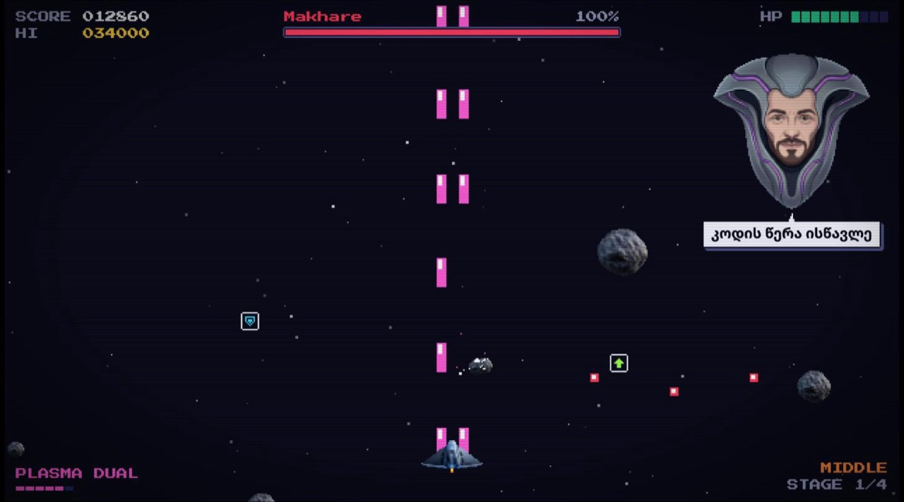

# Space Defenders

პიქსელ-არკადული კოსმოსური შუტერი სუფთა ჯავასკრიპტზე, ბიბლიოთეკების გარეშე.
პროექტი სასწავლოა: შენ შეგიძლია დაამატო **საკუთარი ბოსი, ლეველი, იარაღი ან ბონუსი** და ამ დროს ისწავლო
კლასები, მოდულები, მასივები, ობიექტები და `canvas`-ზე ხატვა.



## გაშვება

თამაში ES მოდულებს (`import` / `export`) იყენებს, ამიტომ `index.html`-ზე ორჯერ დაწკაპუნებით **არ
გაიხსნება**: ბრაუზერს სერვერი სჭირდება. აირჩიე ერთ-ერთი გზა:

| გზა | რა უნდა გააკეთო |
| --- | --- |
| **VS Code** | დააინსტალირე გაფართოება **Live Server**, `index.html`-ზე მარჯვენა კლიკი → *Open with Live Server* |
| **Node.js** | ტერმინალში, პროექტის საქაღალდეში: `npx serve` |
| **Python** | ტერმინალში, პროექტის საქაღალდეში: `python3 -m http.server` → გახსენი `http://localhost:8000` |

> **ცვლილება არ ჩანს?** ბრაუზერმა შეიძლება ძველი ფაილი დაიმახსოვროს. გააკეთე სრული განახლება:
> `Ctrl + Shift + R` (Mac-ზე `Cmd + Shift + R`), ან DevTools → Network → **Disable cache**.

## მართვა

| ღილაკი | მოქმედება |
| --- | --- |
| მაუსი / `←` `→` / `A` `D` | მოძრაობა |
| კლიკი / `Space` (დააჭირე და გეჭიროს) | სროლა |
| `Esc` / `P` | პაუზა |
| `M` | ხმის ჩართვა/გამორთვა |
| `C` | CRT ეფექტი (ძველი ტელევიზორის ზოლები) |

ტელეფონზე: თითის მოძრაობა ხომალდს ამოძრავებს, ეკრანზე თითის დაჭერა — ისვრის.

## Debug რეჟიმი

მისამართს ბოლოში მიუწერე `?debug`, მაგ.: `http://localhost:8000/?debug`.
შენი ბოსის შესამოწმებლად აღარ მოგიწევს 2 წუთის თამაში:

| ღილაკი | მოქმედება |
| --- | --- |
| `1` – `9` | პირდაპირ N-ე ბოსთან გადასვლა |
| `G` | უკვდავება |
| `H` | hitbox-ების ჩვენება (რა ზომით ეჯახება ობიექტები ერთმანეთს) |
| `K` | ბოსს სიცოცხლე 10%-მდე ჩამოუვა |
| `U` | იარაღის დონის აწევა |

ბრაუზერის კონსოლში ხელმისაწვდომია `game` ობიექტი, მაგ.: `game.health = 100`.

## პროექტის სტრუქტურა

```
index.html              ← HTML: canvas და მენიუს ეკრანები
css/style.css           ← მენიუს, Game Over-ის და Victory-ის სტილი
js/
  main.js               ← შესვლის წერტილი: ტვირთავს სურათებს და იწყებს თამაშს
  config.js             ★ ყველა რიცხვი: სირთულე, იარაღი, ბონუსები, ფერები
  levels.js             ★ ლეველების სია — აქ ამატებ ახალ ლეველს
  bosses/
    Boss.js             ← ყველა ბოსის საბაზისო კლასი და შეტევის დამხმარეები
    _template.js        ★ ახალი ბოსის ნიმუში — დააკოპირე!
    makhare.js, beka.js, lasha.js, nukri.js
  entities/             ← მოთამაშე, ტყვია, მეტეორი, ბონუსი, ნაწილაკი, ვარსკვლავი
  core/
    game.js             ← Game კლასი: თამაშის ციკლი, შეჯახებები, ლეველები
    input.js            ← მაუსი, კლავიატურა, შეხება
    timers.js           ← ტაიმერები, რომლებიც პაუზაზე ჩერდება
    collision.js        ← შეჯახების ფორმულები
    audio.js            ← ხმები (Web Audio API)
    assets.js           ← სურათების ჩატვირთვა და „დაპიქსელება“
    debug.js            ← ?debug რეჟიმი
  ui/
    hud.js              ← ქულა, სიცოცხლე, წარწერები კანვასზე
    screens.js          ← HTML ეკრანები
    draw.js             ← ხატვის დამხმარეები: ტექსტი, ჩარჩო, ხატულა
assets/                 ← სურათები და ხმები
```

★ — ფაილები, საიდანაც დაწყება ღირს.

## როგორ მუშაობს თამაში

თამაში წამში ~60-ჯერ იმეორებს ორ ნაბიჯს (`Game.run()`):

1. **`update(dt)`** — ყველაფერი გადაადგილდება. `dt` წინა კადრიდან გასული დროა წამებში, ამიტომ
   სიჩქარეები „პიქსელი/წამში“-ში იწერება და თამაში 60Hz-იან და 144Hz-იან ეკრანზე ერთნაირად მიდის:
   `this.x += this.vx * dt`.
2. **`draw()`** — ეკრანი იწმინდება და ყველაფერი თავიდან იხატება.

თამაშს აქვს **მდგომარეობები** (`game.state`): `menu` → `playing` ⇄ `paused` → `gameover` / `victory`.

თამაშის ეკრანი ყოველთვის **640×360** „პიქსელია“: ბრაუზერი მას ფანჯრის ზომამდე ზრდის, ამიტომ კოორდინატები
ყველა კომპიუტერზე ერთნაირია.

ყოველი ლეველი ასე მიდის: ჯერ რამდენიმე წამი მეტეორები ცვივა (`meteorTime`), შემდეგ გამოდის ბოსი.
ბოსის მოკვლის შემდეგ იწყება შემდეგი ლეველი, ბოლო ბოსის შემდეგ კი გამარჯვებაა.

## დავალებები

ახლის დამატება როგორ ხდება, დაწვრილებით წერია [CONTRIBUTING.md](CONTRIBUTING.md)-ში.

**დამწყები**
- შეცვალე ბოსის ფრაზები (`talkLines`) ან სიცოცხლე (`hp`)
- დახატე ახალი ხატულა ბონუსისთვის (`config.js` → `POWERUPS` → `icon`)
- დაამატე ახალი სირთულე `DIFFICULTIES`-ში — მენიუში ღილაკი თავისით გაჩნდება

**საშუალო**
- დაამატე საკუთარი ბოსი `_template.js`-ის მიხედვით
- დაამატე ახალი იარაღის დონე `WEAPONS`-ში (მაგ. 7 ტყვია მარაოსავით)
- ახალი ბონუსი: მაგალითად `slow_time`, რომელიც ბოსის ტყვიებს ანელებს

**რთული**
- ბოსი ორი ფაზით: 50%-ზე სხვა შეტევების სია (`onHealthBelow` + `this.attacks = [...]`)
- მტრის ახალი ტიპი (`entities/`-ში ახალი კლასი), რომელიც მოთამაშეს მისდევს
- ფონური მუსიკა (`config.js` → `SOUND_FILES` → `music`) და ხმის სიმძლავრის პარამეტრი მენიუში
- „უსასრულო“ რეჟიმი: ბოლო ბოსის მერე ლეველები თავიდან, უფრო რთულად

## ბმულით თამაში (GitHub Pages)

რეპოზიტორიაში: **Settings → Pages → Build and deployment → Deploy from a branch → `main` / `(root)`**.
რამდენიმე წუთში თამაში გაიხსნება მისამართზე `https://<მომხმარებელი>.github.io/<რეპოზიტორია>/`.

## ლიცენზია

[MIT](LICENSE) — თავისუფლად შეგიძლია გამოიყენო, შეცვალო და გააზიარო.
